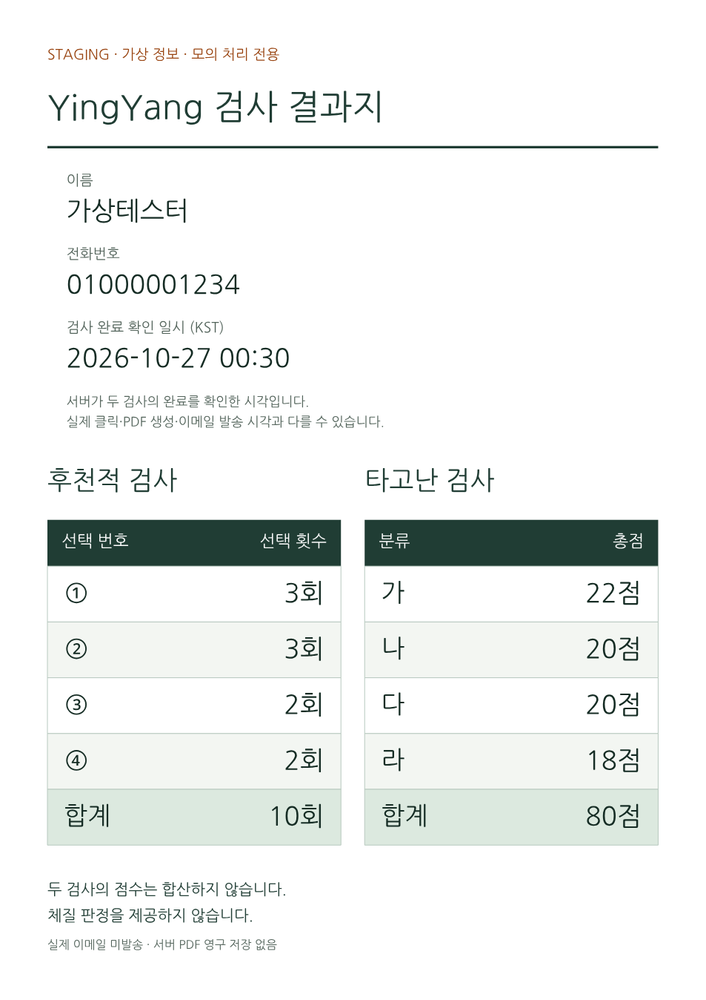

# #5 PDF 개선 — Staging 검수용

2026-10-27. `develop/v1.2`, `yingyangtest` 한정. 한의원 수신 주소 적용과 실제 메일 발송은 이번 작업에서 하지 않는다.

## 레이아웃

제목 29pt, 개인정보 값 22pt, 표 제목 22pt, 항목 21pt, 결과/합계 22pt. 라벨과 값을 분리하고 개인정보 행 간격은 62pt로 넓혔다. A4 세로 1페이지, 좌우 여백 40pt, 두 결과표 사이 20pt를 사용한다. 후천적 표를 왼쪽, 타고난 표를 오른쪽에 같은 높이로 배치하고 합계 행을 강조한다. 원형 숫자는 별도 내장 폰트의 기준선을 보정한다. 점수 집계와 첨부 파일명은 유지한다.

이미지는 실제 서버 PDF 생성 함수를 PDF.js로 렌더링한 가상 자료다. 예시 시각은 고정된 `2026-10-27 00:30`이며 실제 이용자 시각이 아니다. PDF 원본은 저장소에 보관하지 않는다. `npm.cmd run functions:build` 후 `node scripts/render-pdf-preview.cjs`로 재생성할 수 있다.

## 완료 확인 시각

사용자가 승인한 대안으로 실제 최종 클릭 시각 대신 **서버가 두 검사의 완료를 확인한 시각**을 기록한다. 표기는 `검사 완료 확인 일시 (KST)`, `YYYY-MM-DD HH:mm`이다. PDF 생성·메일 발송 시각과 구별한다.

- 두 검사 중 마지막 검사의 완료 버튼을 누르면 기존 Auth/App Check 보호 `stagingStatus`에 완료 확인을 요청한다. 별도 Functions나 유료 리소스를 추가하지 않는다.
- 서버는 문항 수·응답 범위를 검증하고 서버 시각, 무작위 회차 식별자, 계정/응답의 HMAC을 서명한다. 브라우저가 전달한 날짜는 받지 않는다. 이름·전화번호를 이 요청에 보내지 않는다.
- 서명 증명은 브라우저의 별도 Staging 키에만 저장한다. 서버에는 응답·시각 증명·개인정보·PDF를 영구 저장하지 않는다. PDF 생성 전 서명, 계정, 응답, 미래 시각을 다시 검증한다.
- 새로고침과 글자 크기 변경은 증명을 유지한다. 답변 변경·재검진은 기록을 무효화하고, 같은 답변으로 재검진해도 새로운 확인을 요청한다. 오래 걸린 이전 요청의 응답은 재검진 기록을 되살리지 못한다.
- 통신 실패 시 보류 중인 확인을 재시도한다. 확인에 성공한 시각이 기록되므로 오프라인 클릭 시각을 소급하지 않는다. 완료 시각 확인 실패 상태에서는 전송을 실패로 처리하고 재시도를 안내한다.
- 기존 완료 데이터에는 완료 기록을 임의로 발급하지 않는다. `기록 없음 (이전 완료 데이터)`를 표시한다.

서명은 날짜와 응답의 위변조를 막지만, 브라우저가 실제로 문항을 읽었는지나 최종 클릭 순간을 증명하지 않는다. 서버에 회차 상태를 영구 저장하지 않으므로 악의적으로 보관한 과거 증명과 같은 응답을 재제출하는 행위까지 차단하는 구조는 아니다. 정상 UI의 재검진 무효화와 구분한다. 로그는 기존 정책을 유지하며 원본 요청/증명/PDF를 애플리케이션 로그에 출력하지 않는다.

## 검증

기존 테스트와 함께 KST 자정 경계, 생성/재시도 시각과의 분리, 서명·계정·응답 위변조, 미래 시각, 불완전 응답, 과거 데이터, 새로고침, 재검진, 늦은 응답 무효화를 검증한다. PDF.js로 A4 1페이지, 표 상단 정렬, 글자 크기, 텍스트 좌표의 페이지 범위, 한글·원형 숫자·전화번호·집계를 확인하고 PNG를 시각 검수한다.

실제 기기/Safari, 실제 프린터 출력은 이번 검증 범위에 포함하지 않는다. 실제 이메일 시험은 반복하지 않는다. 사용자 PDF 승인 전 이슈 #5는 열린 상태로 유지하며 운영 배포·main 병합·출시 태그 생성을 하지 않는다.

### 배포 후 결과

- 구현 커밋 `00361c6`, `yingyangtest` Hosting/기존 Functions 4개 배포 성공. 새 서비스·유료 리소스 추가 없음.
- `npm.cmd test`: UI/엔진 41개 + 배포 보호 2개 통과. 서버 테스트 29개 통과. 합계 72개. 운영·Staging·서버 빌드 성공.
- 실제 Staging Chrome + Auth/App Check: 최종 완료 확인 증명 발급, 새로고침 후 증명 유지, 증명을 포함한 PDF 모의 처리 성공. 변조된 증명은 HTTP 400으로 거부.
- 독립 재검진 시 다른 검진 유지 및 증명 제거 확인. 타고난 40문항을 다시 완료하여 새로운 확인 증명을 발급받음.
- 320/390/768/820/1024/1440px × 소/중/대 = 18조합에서 가로 넘침 없음, 글자 크기 변경에도 증명 유지.
- Staging HTTP 200 및 배포 HTML/빌드 일치. 운영 HTTP 200 및 기존 HTML 해시 일치. 실제 발송 창은 계속 닫혀 있고 당일 실제 발송 시도는 기존 1건 그대로다. 사용자 PDF 최종 검수를 기다린다.
